<p align="center">
  
</p>

### `~/projects`

**[aurum](https://github.com/Yumstezy/CSUHackathon2026)**
Forecasts corn yields across 263 counties 4 to 5 months before the USDA does, using NASA satellite imagery. Won the NASA & USDA challenge at CSU Hackathon 2026. Hit 0.789 R² after I caught and fixed a data leak.
<sub>`python` `xgboost` `aws s3` `sagemaker` `databricks` `next.js`</sub>

**[gone-phishin](https://gonephishin.tech)**
Chrome extension that stops older users from clicking phishing links, with a dashboard so family can keep an eye on things. Live on the Chrome Web Store.
<sub>`typescript` `react` `next.js` `postgresql`</sub>

**[brkt-battle](https://brktbattle.com)**
1v1 tournament platform with live brackets, a leaderboard, and prize payouts in SOL.
<sub>`typescript` `next.js` `node.js` `postgresql` `solana`</sub>

**jellyfish**
My own Linux distro, built as one reproducible Nix flake with a desktop shell written from scratch. Still in progress.
<sub>`nix` `nixos` `wayland` `systemd`</sub>

### `~/stack`

<p>
  
</p>

### `~/now`

```
building    jellyfish
learning    c++, deeper
studying    aws solutions architect associate
```

### `~/contact`

[barrie.dev](https://www.barrie.dev/) &nbsp;/&nbsp; [linkedin](https://www.linkedin.com/in/ian-barrie-b25675333/) &nbsp;/&nbsp; ianartbarrie@gmail.com
